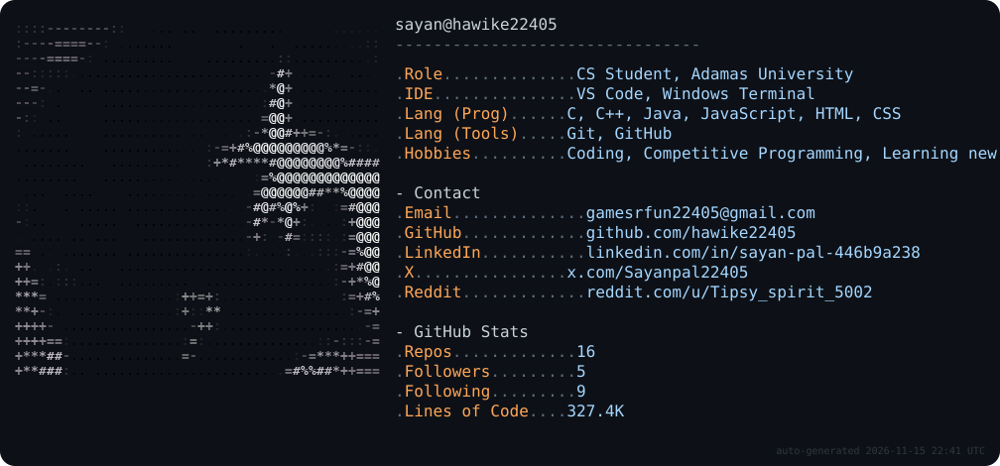

<!--
  This card is generated by generate_card.py and kept up to date by
  .github/workflows/update-card.yml, which:
    - fetches the LIVE avatar from https://github.com/hawike22405.png every run,
      so the ASCII art updates automatically whenever the avatar changes
    - re-runs on a schedule, on manual trigger, and when generate_card.py changes
  Edit the CONFIG dict at the top of generate_card.py to update your
  role / tech stack / contact info, then let the workflow (or a manual
  `python generate_card.py` run) regenerate profile-card.svg.
-->

# 👨🏻‍💻 About Me:
🔭 I'm currently a student at Adamas University 🤝 I'm looking for help with knowing how to do some advanced coding  🌱 I'm currently learning Java, Java Script, Html, CSS.

## 🌐 Socials:
   

# 💻 Tech Stack:
## 💻 Tech Stack

### Programming Languages

### Web Development

### Databases

### 🌐 Networking & Simulation Tools

### 🔧 Hardware Description & Microprocessor Tools

### 🛠️ Tools & Platforms

**Version Control & Containers**

**Operating Systems & Linux Distributions**

**Terminals & Shells**

**Desktop Environments & Window Managers**

### Design & Creative Tools

### 🚀 Deployment & Hosting

# 📊 GitHub Stats:

 

 
 

# 🟨 Contribution Graph:

  <picture>
    <source media="(prefers-color-scheme: dark)" srcset="https://raw.githubusercontent.com/hawike22405/hawike22405/main/pacman/dist/pacman-contribution-game-dark.svg">
    <source media="(prefers-color-scheme: light)" srcset="https://raw.githubusercontent.com/hawike22405/hawike22405/main/pacman/dist/pacman-contribution-game-light.svg">
    
  </picture>

## 🏆 GitHub Trophies

### ✍️ Random Dev Quote

### 🔝 Top Contributed Repo

---

